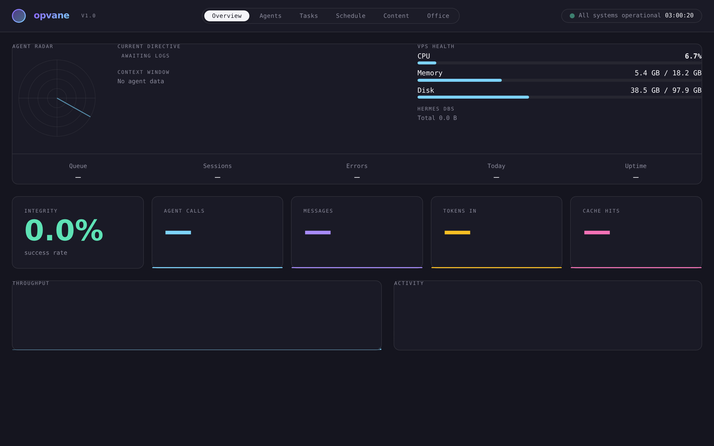
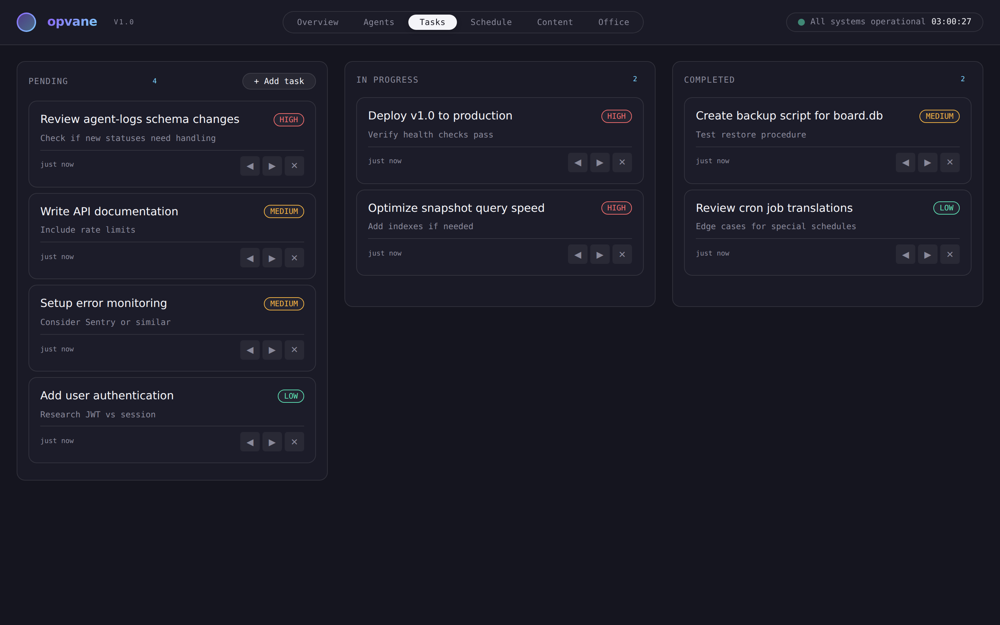
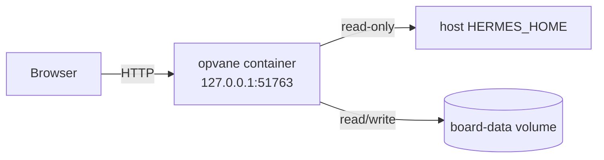

<div align="center">


# opvane

**A self-hosted AI agent operations dashboard — real-time fleet status, task board, schedule view, and content browser.**

*Formerly OpsCenter.*

[](https://github.com/OneByJorah/opvane/actions/workflows/ci.yml)
[](https://github.com/OneByJorah/opvane/actions/workflows/docker.yml)
[](https://github.com/OneByJorah/opvane/releases)
[](https://github.com/OneByJorah/opvane/pkgs/container/opvane)
[](https://opensource.org/licenses/MIT)

</div>



## What This Is

opvane is a single-page operations dashboard for Hermes-style AI agent fleets. It reads agent logs, session metadata, and gateway state from the host Hermes home directory, and provides a task board, cron schedule view, and markdown content browser on top.

It runs as one self-contained Python HTTP server with no pip dependencies beyond the standard library. Docker Compose is the recommended deployment.

## Features

- **Overview dashboard** — agent radar, activity stats, VPS health, Hermes DB sizes, and live SSE updates.
- **Agents view** — per-agent response counts, success rate, model used, and recent task log.
- **Task board** — kanban-style columns (pending, in-progress, completed) backed by a local SQLite database.
- **Schedule view** — human-readable translation of system and Hermes cron jobs.
- **Content browser** — read markdown files from the configured content directory.
- **Docker-first** — one command start with a read-only root filesystem, dropped capabilities, and a non-root user.

## Quick Start (Docker)

```bash
git clone https://github.com/OneByJorah/opvane.git
cd opvane
cp .env.example .env
# Edit .env: set HERMES_HOME to the absolute path of your Hermes state directory.
docker compose up -d --build
curl http://127.0.0.1:51763/api/health
```

Open `http://127.0.0.1:51763` in a browser.

To stop and remove the volume:

```bash
docker compose down -v
```

## Quick Start (From Source)

```bash
git clone https://github.com/OneByJorah/opvane.git
cd opvane
python3 -m venv .venv
source .venv/bin/activate
pip install -r requirements.txt
python3 server.py
```

The server listens on `http://127.0.0.1:51763` by default.

## Screenshots

| Dashboard | Task Board |
| --- | --- |
|  |  |

## Configuration

Copy `.env.example` to `.env` and adjust these values:

| Variable | Default | Description |
| --- | --- | --- |
| `PORT` | `51763` | HTTP port inside the container and on the host. |
| `BIND` | `0.0.0.0` | Bind address inside the container. Keep `0.0.0.0` for Docker. |
| `MISSION_CONTROL_API_KEY` | empty | If set, required via `X-API-Key` header for write endpoints. |
| `HERMES_HOME` | `/home/user/.hermes` | Absolute host path to the Hermes state directory, mounted read-only. |
| `MISSION_CONTROL_CONTENT_DIR` | `/app/content` | Directory inside the container for markdown content files. |

## Architecture



- The Python server (`server.py`) serves the static UI and JSON/SSE API.
- The UI (`index.html`, `app.js`, `components.js`) polls `/api/snapshot` and renders tabs.
- The board database is persisted in the `board-data` Docker volume.

## API Endpoints

| Method | Path | Description |
| --- | --- | --- |
| GET | `/` | Dashboard UI. |
| GET | `/api/health` | Health check. |
| GET | `/api/snapshot` | Full state snapshot. |
| GET | `/events` | Server-sent events stream. |
| GET | `/api/board` | List board tasks. |
| POST | `/api/board` | Create a task. |
| POST | `/api/board/update?id=...` | Update a task. |
| POST | `/api/board/delete?id=...` | Delete a task. |
| GET | `/api/content` | List markdown content files. |
| GET | `/api/content/get?path=...` | Read a markdown file. |
| POST | `/api/content/save` | Save a markdown file. |

## Roadmap

- Add authentication and per-user boards.
- Persist content edits to a named volume.
- Add agent log filtering by model and status.

## Contributing

See [CONTRIBUTING.md](CONTRIBUTING.md). Open an [issue](https://github.com/OneByJorah/opvane/issues) to report a bug or request a feature.

## Security

See [SECURITY.md](SECURITY.md). Run `gitleaks detect --redact --no-banner` before committing.

## License

MIT — see [LICENSE](LICENSE).
